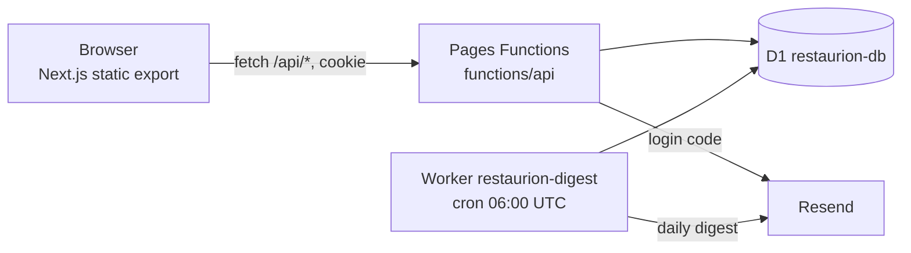
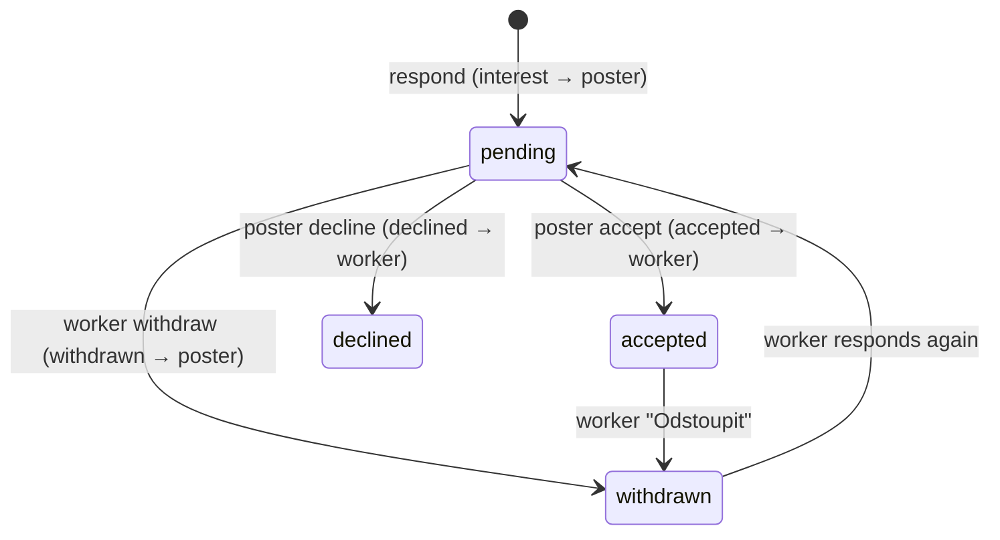

# Restaurion – Architecture

Restaurion is a job board and directory for restorers and craftspeople in Czechia.
Posters publish jobs with a date range and crafts. Every matching worker is notified, shows interest, and the poster accepts or declines.
A public directory (Adresář) lists firms, licensed and unlicensed restorers.

Related documents:
- [`DECISIONS.md`](DECISIONS.md) – why the system looks like this.
- [`STATUS.md`](STATUS.md) – what is deployed, open risks, next steps (read this first in a new session).
- [`BACKEND-PLAN.md`](BACKEND-PLAN.md) – endpoint table and migration notes (Czech).
- [`UI-DESIGN.md`](UI-DESIGN.md) – binding visual contract (Czech).
- [`../src/types/api.ts`](../src/types/api.ts) – the API contract. It is the single source of truth for request and response shapes.

## 1. Components

| Part | Where | Notes |
| :--- | :--- | :--- |
| Frontend | `src/` | Next.js 16 with `output: 'export'`. All pages are client components that call `/api/*`. No SSR, no Next API routes. |
| API | `functions/api/` | Cloudflare Pages Functions, file-based routing. Files starting with `_` are helpers, not routes. |
| Database | D1 `restaurion-db` (binding `DB`) | One database for production, preview, and the digest worker. |
| Email | Resend | `RESEND_API_KEY` + `RESEND_FROM`. Not configured yet (see STATUS). |
| Scheduled jobs | `workers/digest/` | A separate Worker, because Pages Functions cannot run Cron Triggers. Shares code with `functions/api/_lib/digest.ts`. |

## 2. Code map

| Concern | File |
| :--- | :--- |
| Matching rule (the only copy) | `src/lib/matching.ts` – `evaluateMatch`, `countBusyDays`, `daysInRange` |
| Craft ids and legacy mapping | `src/lib/crafts.ts` – ids `kámen`, `dřevo`, `malba`, `kov`, `zlacení`; `toCraftIds` maps old free text |
| Row mappers, contact helper, auth, rate limit, email | `functions/api/_shared.ts` |
| Busy-slot and candidate loading | `functions/api/_lib/data.ts` – `loadBusySlots`, `loadMatchCandidates` |
| Input validation and contact normalisers | `functions/api/_lib/validate.ts` |
| Digest selection, HTML, cleanup | `functions/api/_lib/digest.ts` |
| Frontend fetch wrapper | `src/lib/api.ts` |
| Main page, tabs, modals | `src/app/page.tsx` + `src/components/*` |

Code under `functions/` and `workers/` imports with explicit `.ts` extensions. `tsconfig.json` sets `allowImportingTsExtensions` and excludes `tests/`.

## 3. Authentication

1. `POST /api/auth/request-code` stores a SHA-256 hash of a 6-digit code in `login_codes` (valid 10 min) and sends it by email.
2. `POST /api/auth/verify-code` consumes one attempt atomically on the latest code (`UPDATE … RETURNING`, max 5). Then it accepts the guess against any unexpired code of that email.
3. On success it creates the profile if missing (`consent_at` set, name empty), stores a hashed session token in `auth_sessions`, and sets the `restaurion_session` cookie (HttpOnly, Secure, SameSite=Lax, 30 days).
4. Every endpoint resolves the user with `getAuthenticatedUserId` / `requireUser` in `_shared.ts`.

Rate limits (`rateLimit` in `_shared.ts`, table `rate_limit_events`): the event is inserted first and then counted, and a rejected request deletes its own row.

| Bucket | Limit |
| :--- | :--- |
| request-code per email | 5 / h |
| request-code per IP | 20 / h |
| verify-code per IP | 30 / h |
| verify-code per email | 10 / h |

Test mode: when Resend is not configured and `TEST_LOGIN_ECHO=1`, request-code returns `testCode` in the response. The UI prefills it.

## 4. Core flows

**Post a job** (`POST /api/jobs`, `functions/api/jobs.ts`)
1. Validate (`validateNewJob`). The poster must have a profile name of 3+ characters.
2. Insert the job with `visibility = 'public'` and an `expires_at`.
3. For `subcontract_needed` and `guarantor_needed` jobs, `loadMatchCandidates` loads workers with `accepting_jobs = 1` and `consent_at` set, plus only their busy data that overlaps the range.
4. `evaluateMatch` decides per worker. Matches get a `job_match` notification with `busyDays`.
5. Offers (`craftsman_available`) skip steps 3–4 (`notified: 0`).

**Matching rule** (`evaluateMatch`): the job is active and not expired, the worker accepts jobs and is not the poster, the crafts intersect, and `busyDays < totalDays`.
A partial overlap still matches. Only the worker sees "V tomto termínu máš X dní obsazeno".

**Busy days** come from the worker's unavailability blocks plus accepted engagements on jobs with `status = 'active'` and `job_type IN ('subcontract_needed', 'guarantor_needed')`. Offers never count.

**Engagement lifecycle** (`engagements`, unique per job and worker)

- Accept is allowed only on an active, unexpired job. It returns 409 when the worker's busy days (excluding this job) cover the whole range.
- Accept on an offer returns 409. Decline on an offer is allowed.
- Closing a job (`PATCH /api/jobs/:id` with `status: 'closed'`, stored as `archived`) is one atomic batch. It sends `job_closed` to everyone with a pending or accepted engagement. A closed job no longer counts as busy.

**Directory** (`GET /api/directory`): lists profiles with `directory_visible = 1`, `consent_at` set and a name of 3+ characters. Max 200 entries. Ordered by name. The `region` filter also matches `Celá ČR`.

## 5. Privacy invariants

These are enforced in code and checked by `scripts/e2e-local.sh`. Do not break them.

| Rule | Enforced in |
| :--- | :--- |
| Contacts (email, phone, web, Instagram, WhatsApp, Facebook) only for a logged-in viewer | `mapContact` / `mapContactPrefixed` in `_shared.ts`, called only when a session exists |
| Unavailability blocks and busy days never leave their owner | only `OwnProfile` and viewer-specific `myBusyDays` |
| Poster sees interested workers only on their own job | owner check in `jobs/[id]/engagements.ts` |
| Matching and digest only for profiles with consent | `consent_at IS NOT NULL` in `loadMatchCandidates` and the digest query |
| No secret values in git | only names: `RESEND_API_KEY`, `RESEND_FROM`, `APP_URL`, `TEST_LOGIN_ECHO` |

## 6. Data model

Legacy tables from `0001`–`0005` (`profiles`, `jobs`, `auth_sessions`, `job_responses`, `job_reviews`, `site_settings`, `photos`, `mk_licenses_cache`, `auth_codes`) still exist. The MVP code uses only `profiles`, `jobs` and `auth_sessions` from them.

| Table | Purpose | Key columns |
| :--- | :--- | :--- |
| `profiles` | user | `crafts` (JSON ids), `experience_text`, `portfolio_url`, `licence_number`, `licence_verified` (unused since D25, column kept), `email_digest`, `accepting_jobs`, `consent_at`, `directory_group`, `directory_visible`, `instagram`, `whatsapp`, `facebook` |
| `jobs` | job or offer | `job_type`, `date_from`, `date_to`, `visibility`, `expires_at`, `status` (`active` / `archived`) |
| `unavailability_blocks` | private busy ranges | `profile_id`, `date_from`, `date_to` |
| `engagements` | interest and acceptance | `job_id`, `worker_id`, `status`, `UNIQUE(job_id, worker_id)` |
| `notifications` | in-app + digest | `type`, `read_at`, `emailed_at` |
| `login_codes` | email login | `code_hash`, `expires_at`, `attempts` |
| `rate_limit_events` | rate limiting | `bucket`, `key_hash`, `created_at` |
| `email_log` | daily email budget | `kind` (`login_code` / `digest`), `profile_id` |

Dates are `YYYY-MM-DD` calendar days without a time zone. Timestamps are SQLite `datetime('now')` in UTC.

## 7. Email and digest

- Budget: 100 emails/day (`DAILY_EMAIL_BUDGET`). Login codes to addresses without a profile share 50/day. The digest keeps 10 in reserve for login codes.
- The digest worker runs at 06:00 UTC. It first deletes old `rate_limit_events` (> 2 days) and expired `login_codes` (> 1 day). Then, if Resend is configured, it emails users with unread, un-emailed notifications, oldest first.
- A failed login-code send deletes the code and returns 502.

## 8. Migrations

- Run with `npx wrangler d1 execute restaurion-db --file=migrations/<file>`, local first, then `--remote`. Do not use `migrations apply`: earlier migrations were run with `execute`, so the `d1_migrations` table is incomplete.
- Additive only: `ALTER TABLE ADD COLUMN`, new tables, backfills. No `DROP`, no destructive `ALTER`.
- Procedure: back up (`wrangler d1 export restaurion-db --remote --output=backups/backup-<name>-<YYYY-MM-DD-HHMMSS>.sql`), record row counts, apply, compare row counts.
- `0006` and `0007` are not idempotent (`ADD COLUMN`). Never run them twice.

## 9. Testing

| Command | What |
| :--- | :--- |
| `npm test` | unit tests in `tests/*.test.ts` with Node's native TypeScript stripping (Node 25) |
| `bash scripts/e2e-local.sh` | resets local D1, applies `0001`–`0007`, starts `wrangler pages dev` on `:8788` with a stub page, drives the API with curl. Prints PASS/FAIL per check. |
| `npx tsc --noEmit -p .`, `npx eslint src`, `npm run build` | type check, lint, static export |

A change to an endpoint changes `src/types/api.ts`, the tests and `scripts/e2e-local.sh` together.

## 10. Deployment

| Target | Command | Notes |
| :--- | :--- | :--- |
| Pages (frontend + API) | `npm run deploy` (= build + `wrangler pages deploy out --project-name restaurion --branch=main`) | `--branch=main` makes it the production deployment, also from `mvp-core` |
| Digest worker | `npx wrangler deploy -c workers/digest/wrangler.json` | needs its own secrets |
| Pages secrets | `npx wrangler pages secret put <NAME> --project-name restaurion` | |
| Worker secrets | `npx wrangler secret put <NAME> -c workers/digest/wrangler.json` | |

`.github/workflows/deploy.yml` builds on every push to `main` but never deploys: its deploy step checks `if: env.CLOUDFLARE_API_TOKEN != ''`, and a step's `if` cannot see that step's own `env`. The repo also has no secrets. Deploys are manual.

Use `--registry https://registry.npmjs.org/` for every `npm`/`npx` install on this machine.

## 11. Known limits

- Two posters who accept the same worker at the same moment can double-book them. The busy check and the update are not one transaction.
- The directory returns at most 200 entries and has no pagination.
- Any logged-in user can read all contacts (owner decision).
- No photo upload, no admin UI, no reviews. Licences are self-declared and not verified (D25). Rewards are structured (`reward_type`, `reward_amount`, `reward_currency`, `reward_scope`, migration 0009; `budget_note` is derived).
